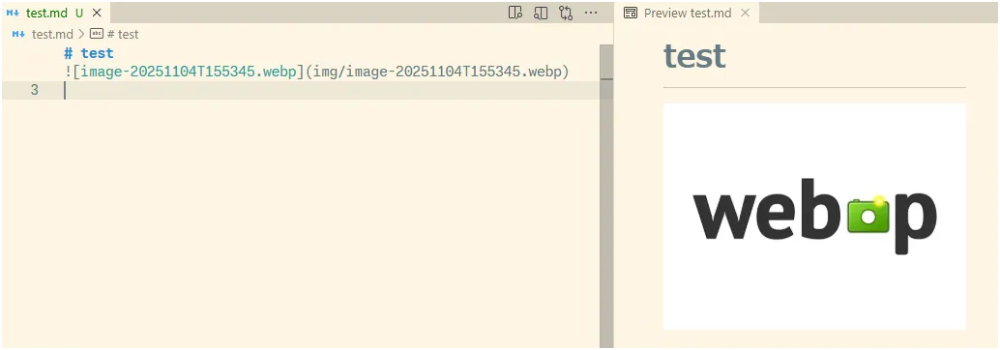

# WebP Image Paster

[English README](README.md)

クリップボード画像をWebP形式に変換し, Markdownファイルに直接貼り付けるVSCode拡張機能です。
（サブ機能として中身がURLの場合は，タイトル補完してペースト）



## 目的,機能

- **ファイルサイズ削減** - PNGより小さく．ロスレス対応
- **貼り付けパターンのカスタマイズ** - htmlタグを使った50%縮小貼り付けなど
- **画像名に日時を入れてユニークに**
- **クロスプラットフォーム動作** - Windows、macOS、Linux，リモート(WSL、ssh、devcontainer)
- **URLタイトル補完**

## インストール

VSCode Marketplaceからインストール（追加セットアップ不要）

## 使い方

1. 画像またはURLをクリップボードにコピー
2. VSCodeでMarkdownファイルを開く
3. `Ctrl+V`（MacではCmd+V）を押す

**その他の方法:**

- コマンドパレット → "Paste as WebP in MD"

## ⚙️ 設定

詳細は設定の説明文を参照

```json
{
  "vsc-webp-paster.imageDir": "img",
  "vsc-webp-paster.quality": 80,
  "vsc-webp-paster.namingConvention": "image-${timestamp}",
  "vsc-webp-paster.insertPattern": "",
  "vsc-webp-paster.useWorkspaceRoot": false,
  "vsc-webp-paster.progressDelay": 0.3,
  "vsc-webp-paster.convertUrlToLink": true,
  "vsc-webp-paster.urlFetchTimeout": 1500
}
```

URL変換では静的HTMLのページタイトルを取得します．1sタイムアウトまでに取得できない場合は元のURLを貼り付けます．通信せずURLをそのまま貼り付ける場合は `convertUrlToLink` を `false` にします．

## 📋 要件

- VSCode 1.118.0以上
- darwin-arm64, win32-x64, linux-x64, linux-arm64

**クリップボード取得方法:**

- **Windows**: PowerShell (.NET System.Windows.Forms.Clipboard)
- **MacOS**: AppleScript (osascript)
- **Linux**: xclip (X11) または wl-paste (Wayland) - インストール必要
- **WSL / SSH**: 可能なら Windows 側 PowerShell を優先し, それ以外はクライアント側 OS の方式を使う

## 📝 ライセンス

MIT License

## 制限事項

Markdown Editor (Experimental) は、カーソル位置への挿入に必要な標準の Text Editor API を公開していないため、現在未対応です。
